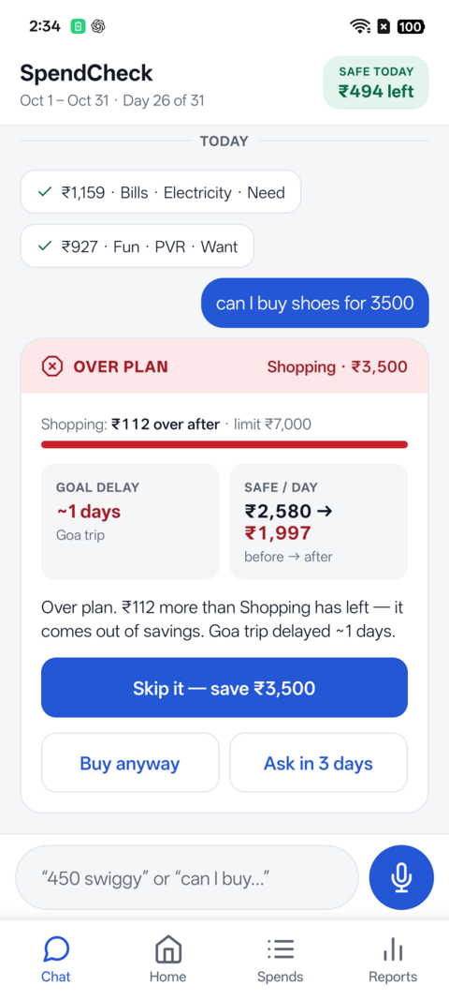
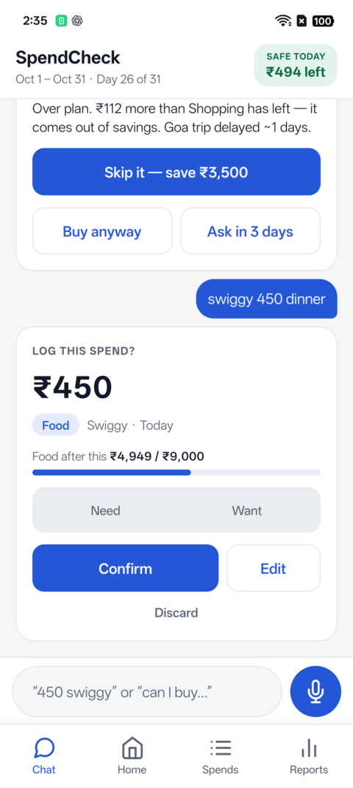
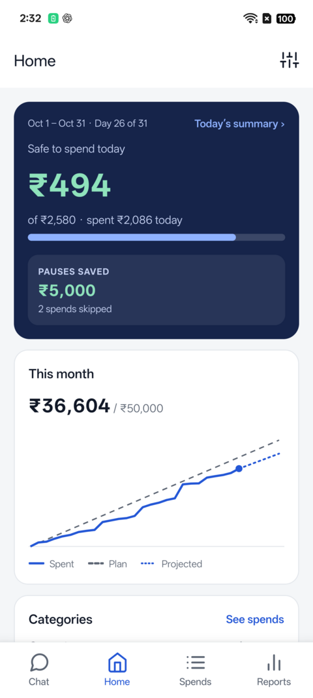
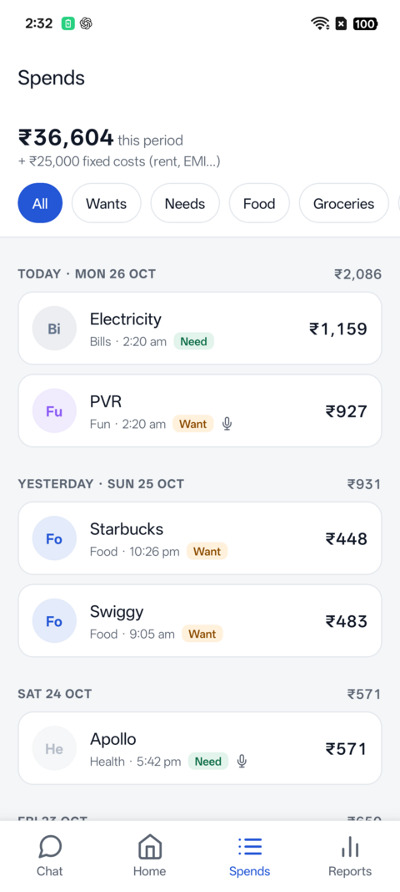
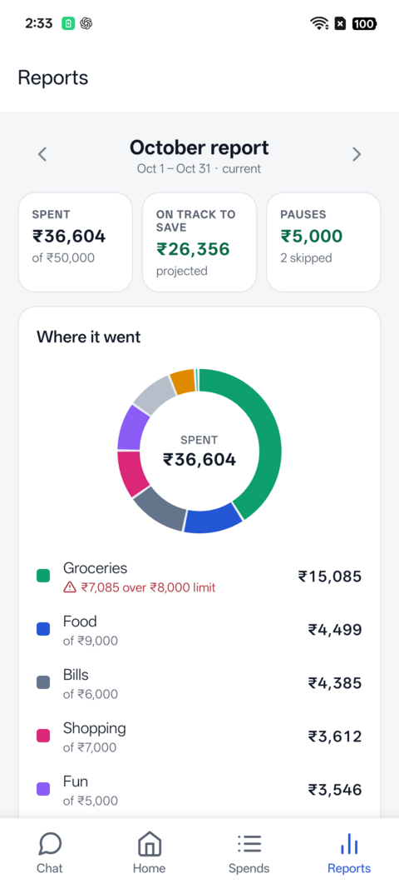
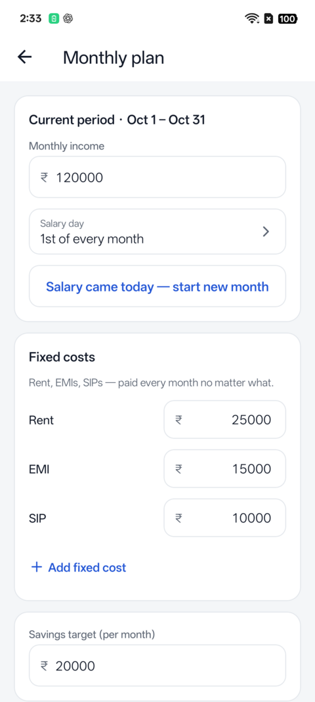

# SpendCheck

Personal budgeting app that checks a spend against your monthly plan *before* you make it.
Tell it "can I buy shoes for 3500?" by voice or text and it answers with what that does to
your category limit, today's safe spend, your savings target and your goals. Log spends the
same way ("450 swiggy"), and see where the month is heading on the dashboard and reports.

- **api/** — Spring Boot 3.5 (Java 21), Postgres 16, Flyway, JWT auth, OpenAI via Spring AI
- **app/** — Expo SDK 57 / React Native (TypeScript, expo-router), Android first

## How it works

```
voice / text ──► /inputs ──► speech-to-text ──► LLM extraction (JSON schema)
                                  │
                                  ▼
                      deterministic post-processing
                (category by name/alias, amount & date rules,
                 follow-up questions when unsure)
                                  │
             ┌────────────────────┼─────────────────────┐
             ▼                    ▼                     ▼
        spend draft        pre-spend verdict      budget answer
     (you confirm it)   GREEN / AMBER / RED +    (left in category,
                         goal delay, safe/day     safe today, …)
                                  │
                                  ▼
                 budget engine (pure Java, unit-tested)
```

- The LLM only extracts structure from what you say. All money math is deterministic Java
  in `api/.../engine` — rules in [docs/ENGINE.md](docs/ENGINE.md).
- Nothing the LLM produces is saved until you confirm it; undo asks before removing.
- The OpenAI key lives only in the backend environment, never in the app.
- The API contract is in [docs/API.md](docs/API.md).

## Screenshots

<table>
  <tr>
    <td align="center"><br><sub><b>Pre-spend check</b> — verdict before you buy</sub></td>
    <td align="center"><br><sub><b>Log by text/voice</b> — confirm, edit or discard</sub></td>
    <td align="center"><br><sub><b>Home</b> — safe today, burn vs plan</sub></td>
  </tr>
  <tr>
    <td align="center"><br><sub><b>Spends</b> — filterable, needs vs wants</sub></td>
    <td align="center"><br><sub><b>Reports</b> — where it went, on-track-to-save</sub></td>
    <td align="center"><br><sub><b>Plan</b> — income, fixed costs, limits</sub></td>
  </tr>
</table>

## Screens

Chat (text + press-and-hold voice, confirm cards, verdict cards) · Home (safe to spend today,
month burn vs plan with projection, category status, goal) · Spends (filter, edit, delete) ·
Reports (category donut, needs vs wants, top wants, weekday pattern, trend) · Plan (income,
salary day, fixed costs, savings, goals, category limits) · Daily summary (21:30 reminder).

## Run locally

Prerequisites: Docker, JDK 21+, Node 20+, an Android phone with Expo Go (SDK 57) or the APK.

```bash
cp .env.example .env          # DB_PASSWORD, JWT_SECRET, APP_USER_*, OPENAI_API_KEY, models
docker compose up -d postgres # Postgres 16 on localhost:5433

cd api && ./mvnw spring-boot:run      # API on :8077

cd app && cp .env.example .env        # EXPO_PUBLIC_API_URL=http://<laptop-ip>:8077
npm install && npx expo start -c      # scan the QR code with Expo Go
```

The phone must reach the laptop on the same Wi-Fi. If the network isolates devices, use
`npx expo start --tunnel` for the bundle and a Tailscale IP for `EXPO_PUBLIC_API_URL`.

### Standalone APK (no Expo Go)

```bash
cd app
npx expo prebuild --platform android --no-install   # generates android/ (git-ignored)
git checkout package.json                           # prebuild rewrites the scripts
cd android && JAVA_HOME=/usr/lib/jvm/java-17-openjdk-amd64 ./gradlew assembleRelease
# → android/app/build/outputs/apk/release/app-release.apk  (debug-signed, for sideloading)
```

`EXPO_PUBLIC_API_URL` is baked in at build time; rebuild after the laptop IP changes.

## Tests

```bash
cd api && ./mvnw verify        # engine unit tests + Testcontainers integration tests (Docker)
cd api && ./mvnw -Peval test   # NLU eval: real OpenAI calls over 147 golden utterances
                               #   → target/nlu-eval-report.md (~150 calls, a few cents)
cd app && npx tsc --noEmit && npx expo lint && npx jest
```
